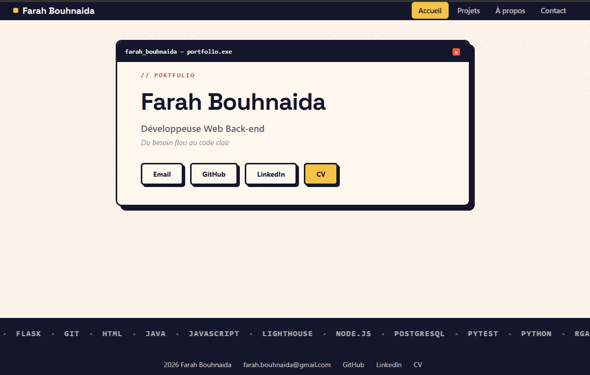

<div align="center">

# Portfolio personnel

**Mon portfolio de développeuse Web : projets, compétences et parcours**


[Démo en ligne](https://farahbouh.netlify.app/) · [Installation](#mise-en-place) · [Signaler un bug](../../issues)



</div>

---

## Pourquoi ce projet ?

Portfolio personnel développé en Flask pour présenter mes projets, mes compétences et mon parcours professionnel.

Le site affiche les projets et les compétences à partir de fichiers JSON, avec un front dynamique en JavaScript.

L’objectif était de proposer une vitrine simple, claire et facilement modifiable sans toucher au code métier.

---

## Stack technique

| | |
|---|---|
| **Frontend** | HTML, CSS, JavaScript |
| **Backend** | Python, Flask |
| **Données** | Fichiers JSON (`data/projets.json`, `data/competences.json`), éditables sans toucher au code |
| **Formulaire de contact** | Formspree |

__*Pourquoi cette stack* ?__

La stack a été choisie pour un site simple, lisible et facilement maintenable. Flask permet de servir le contenu de manière légère, tandis que JavaScript et JSON assurent une gestion dynamique des projets et des compétences sans complexifier l’architecture.

Le site reste volontairement léger, avec peu de routes et une structure simple à comprendre, ce qui facilite sa maintenance et son évolution.

---

## Fonctionnalités

- Parcourir mes projets et les filtrer par compétence
- Afficher les médias disponibles d'un projet (vidéo, documentation…) et masquer les badges correspondants quand ils n'existent pas (automatique)
- Consulter mes compétences (défilement animé) et ma page À propos
- Me contacter via un formulaire
- Naviguer sur téléphone ou ordinateur, avec animations au scroll et effet machine à écrire sur l'accueil
---

## Mise en place

Il vous faut Python 3.

**Windows (PowerShell) :**

```powershell
git clone https://github.com/farahbouh/Portfolio.git
cd Portfolio
python -m venv .venv
.venv\Scripts\Activate.ps1
pip install -r requirements.txt
python app.py
```

**Linux / macOS :**
```bash
git clone https://github.com/farahbouh/Portfolio.git
cd Portfolio
python -m venv .venv
source .venv/bin/activate
pip install -r requirements.txt
python app.py
```

Ouvrez http://localhost:5000 et c'est prêt.

<details>
<summary>Structure du projet</summary>

```bash
.
├── data
│   ├── competences.json
│   └── projets.json
├── images
│   └── demo.png
├── scripts
│   ├── competences.js
│   ├── contact.js
│   └── projets.js
├── static
│   ├── videos
│   └── CV_Farah_Bouhnaida.pdf
├── styles
│   └── style.css
├── 404.html
├── README.md
├── app.py
├── apropos.html
├── contact.html
├── index.html
├── merci.html
├── projets.html
└── requirements.txt
```

</details>

<details>
<summary>Ajouter un projet</summary>

Ajoutez une entrée dans `data/projets.json` : la page Projets et le filtre par compétence se mettent à jour automatiquement.

</details>

<details>
<summary>Un problème au lancement ?</summary>

- **Port déjà utilisé** : définissez une autre valeur, par exemple `PORT=5001 python app.py`.
- **Module introuvable** : vérifiez que l'environnement virtuel est activé et relancez `pip install -r requirements.txt`.

</details>

---

## Ce que ce projet m'a appris

- Structurer une application Flask avec des routes et une gestion simple de pages
- Gérer des données dynamiques à partir de fichiers JSON
- Charger et filtrer du contenu en JavaScript sans framework front
- Concevoir une vitrine personnelle claire, modulable et facile à maintenir

---
## Contribuer

Les idées et retours sont les bienvenus : n'hésitez pas à ouvrir un [ticket](../../issues).

---

## Licence

Le code de ce projet est sous licence [MIT](LICENSE).  
Les contenus (textes, images, projets présentés) sont sous [CC BY-NC 4.0](https://creativecommons.org/licenses/by-nc/4.0/deed.fr) réutilisables à des fins non commerciales avec attribution.

---

<div align="center">

Réalisé par [Farah](https://github.com/farahbouh) 

Contact : [LinkedIn](https://www.linkedin.com/in/farahbouh) · [Email](mailto:farah.bouhnaida@gmail.com)

</div>
